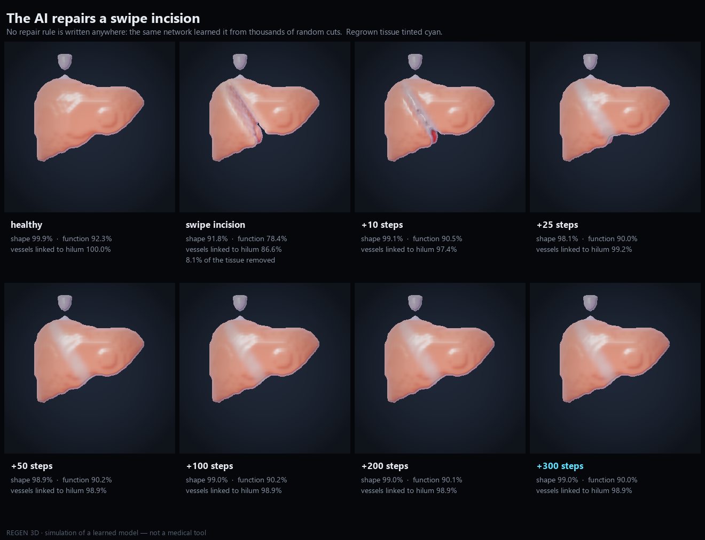

# REGEN 3D — an AI that repairs virtual organs

An interactive 3D body in the browser. Pick an organ, cut it with a swipe, and watch a
learned model analyse the lesion, predict whether it can be repaired, and rebuild the
tissue live: vessels first, then the tissue they feed.

> **Simulation of a learned computational model — not a medical tool.** It does not show how
> real organs heal, and nothing here should be read as medical information.



## What you can do

1. **Explore the body.** Rotate and zoom a 3D human body built from real anatomical meshes.
   *X-ray* fades skin and muscles so only the glowing organs remain.
2. **Pick an organ.** Liver, heart, kidneys, lungs, stomach, spleen, pancreas, brain, the hip end
   of the femur, or a patch of skin anywhere on the body. The camera zooms in and the organ becomes
   a living volume on the GPU.
3. **Make a lesion.**
   - **Swipe** (the main one): a glowing blade trail cuts an incision whose depth follows the speed
     of the gesture. The cut shows a clean, stylised cross-section (no blood).
   - **Puncture**: click to punch a spherical hole; a slider sets its size.
   - **Burn**: press and hold; the damage spreads from that point until you release.
4. **Read the AI's diagnosis.** The model simulates the repair 8 times (it is stochastic, so every
   run differs) and reports a repair probability, the predicted time, how much shape and vascular
   tree come back, and an orange uncertainty map where the runs disagree. If most runs fail, the
   verdict is **NOT REPAIRABLE** and the area that never comes back is shown in red, with the
   measured reasons.
5. **Watch the repair.** A blue hologram shows the predicted shape and dotted lines the vessels that
   will reconnect, then the organ repairs live. Four phases — Sealing, Vessels, Refilling,
   Finishing — light up when the simulation actually reaches them, and the panel ends with the
   forecast next to the actual result.
   - Regrowing cells take the colour of their cell type, and the phase bar lists each type with
     the share rebuilt, numbered in the order the AI completes them.
   - When a cut-off vessel links back to the tree, a light pulse runs from the junction along
     everything that just got its blood back.
6. **Look inside.**
   - **X-ray**: every cell type of the organ in its own colour (see the table below); vessels light
     up where blood reaches them.
   - **Cross-section**: a plane facing the camera that a slider moves through the organ, to watch
     the wound fill from the inside.
   - **AI Brain**: the hidden channels the cells use to talk to each other, glowing where they change.
7. **Check that the AI is doing the work.**
   - **Without AI**: the same lesion repaired by plain hole filling, side by side with the AI.
   - **Watch the AI learn**: the same cut repaired by the model saved at five stages of training.

## How it works

### One small network per organ
Each organ is a 48³ grid of cells. Every cell holds 16 numbers: whether it is alive, four cell
types and 11 hidden channels the network is free to use. The third type is always the vascular
tree (blood comes in through it); the others depend on the organ:

| Organ | Cell types the AI must rebuild |
|---|---|
| Liver | capsule, tissue, vessel tree, central vein |
| Heart | epicardium, muscle wall, coronary arteries, coronary veins (the chambers are empty space it must keep) |
| Kidney | outer cortex, inner medulla, vessels, ureter exit |
| Lung | pleura, tissue, vessels, bronchial tree |
| Bone (femur) | cortical shell, spongy bone, vessels, marrow |
| Skin | epidermis, dermis, small vessels |
| Stomach, spleen, pancreas, brain | outer layer, tissue, vessels, veins or duct |

At every step each cell looks only at its 26 neighbours (3D Sobel filters) and a small MLP shared
by all cells decides its update — a 3D **Neural Cellular Automaton** (Mordvintsev et al., 2020;
Sudhakaran et al., 2021). Nothing in the code says how to repair: the rule is learned.

### Training
`train/train.py` trains in PyTorch with a sample pool. Samples start from the healthy organ and
are repeatedly damaged with the viewer's three lesions — 60% swipe incisions
(`train/damage.py::wedge` matches `wedgeDist` in `web/src/shaders/fields.wgsl`), 25% punctures
and 15% burns that keep spreading for 12 steps while the cells react — so the network learns to
keep the organ stable and to rebuild it. Checkpoints at 8%, 25%, 50%, 75% and 100% of
training feed *Watch the AI learn*.

### Blood supply
Tissue cannot grow out of nothing. Nutrients diffuse from vessels that are still connected to the
hilum (a breadth-first search over the vascular tree); a dead voxel can only become tissue where
the supply reaches at least 10% of its healthy value, and tissue cut off from blood slowly dies.
This is a constraint of the simulated world, not a repair rule: it is why a shredded organ, or one
whose hilum is destroyed, is judged not repairable.

### Metrics
Shape is the 3D IoU with the healthy organ; vessels is the share of the vascular tree present and
linked to the hilum; function is the share of parenchyma that receives enough nutrient.
`eval/metrics.py` and `web/src/metrics.ts` compute the same quantities.

### In the browser
Vite + TypeScript. Three.js draws the body; the organ volume, the cellular automaton, the
diagnosis rollouts and the blood supply all run on the GPU with WebGPU compute shaders, and the
tissue is drawn by ray-marching (translucent, glossy, with subsurface light). Nothing is rendered
while the view is still.

## Running it

Requirements: a browser with WebGPU (Chrome or Edge 113+, Safari 26+), Node 20+.

```bash
cd web
npm install
npm run dev
```

Open http://localhost:5181. The trained models are already exported in `web/public/organs/`.

Training (optional, Python 3.12 + PyTorch with CUDA):

```bash
python -m venv .venv && .venv/Scripts/pip install torch numpy scipy scikit-image trimesh matplotlib fast-simplification
python targets/organ_target.py heart          # voxel target from the body mesh
python train/train.py --organ heart --iters 2500 --ckpt
python train/export.py heart                   # weights + checkpoints for the viewer
python eval/liver_results.py heart             # 3D result images in figures/heart
```

`train/train_all.sh organ1 organ2 ...` chains training, analysis and export.

## Project layout

```
targets/   body model and voxel targets built from BodyParts3D meshes, vascular trees
train/     3D NCA (PyTorch), damage, sample-pool training, export to the viewer
eval/      metrics, offline 3D renderer, result figures, hidden-channel analysis
web/       viewer: Three.js body, WebGPU simulation and ray-marcher, diagnosis, UI
figures/   training results rendered as 3D images, per organ
```

## Limits

- 48³ voxels per organ (about 5 mm per voxel): fine structures such as capillaries are not modelled.
- Organ shapes come from real anatomy; vascular and drainage trees are generated procedurally.
- One model is shared by each pair of kidneys and lungs (the other side is mirrored).
- The repair dynamics, phases and timings are those of a learned automaton, not of biology.

## Credits

- Anatomy: **BodyParts3D**, © The Database Center for Life Science, licensed under
  [CC BY 4.0](https://creativecommons.org/licenses/by/4.0/).
- Mordvintsev, Randazzo, Niklasson, Levin — *Growing Neural Cellular Automata*, Distill, 2020.
- Sudhakaran et al. — *Growing 3D Artefacts and Functional Machines with Neural Cellular Automata*, 2021.
